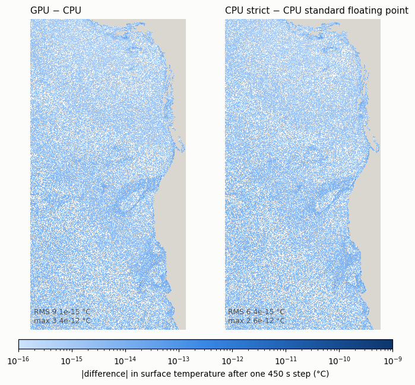
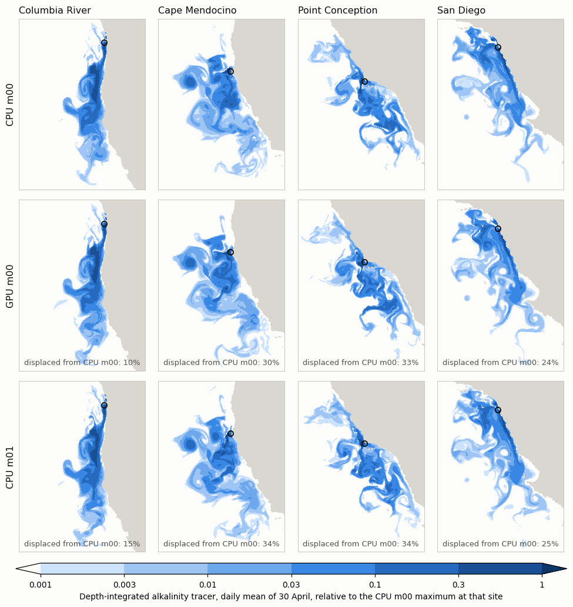

# roms_gpu

A GPU version of the UCLA ROMS ocean model coupled to the MARBL
biogeochemistry library, written in CUDA Fortran for NVIDIA GPUs. The time
step follows CPU UCLA ROMS routine for routine, and the model reads the same
namelists and input files.

**Status:** beta (v0.1.1-beta, October 2026), checked against CPU UCLA ROMS
0.11.0 (see Validation below); MARBL_GPU_PORT.md has the validation history.

## Getting started

### Requirements

- NVIDIA GPUs and the NVIDIA HPC SDK (`nvfortran`; developed with 25.9).
- MPI with Fortran bindings. A CUDA-aware MPI is optional: it lets halo
  exchanges go straight from GPU to GPU; otherwise they go through pinned
  host memory.
- NetCDF-C and NetCDF-Fortran built with parallel I/O (parallel HDF5);
  `nf-config` and `nc-config` on the `PATH`.
- Python 3 for `tools/gpu_layout.py` (standard library only); `numpy` and
  `netCDF4` for the comparison tools.

### Get the code

The repository is private for now; ask for access. MARBL is a git
submodule:

```
git clone --recurse-submodules https://github.com/CWorthy-ocean/gpu-ucla-roms.git roms_gpu
cd roms_gpu
# or, in an existing clone:  git submodule update --init
```

### Build

`make gpu` compiles MARBL's Fortran from the submodule together with the
model and writes `build_gpu/roms_gpu_cuda`. The general form:

```
make gpu FC_GPU=nvfortran \
  FFLAGS_GPU="-O2 -g -cuda -gpu=cc80 -DUSE_CUDA -DPASSIVE_FP64 -Mpreprocess -Mfree -Mnofma -Isrc/shared $(nf-config --fflags)" \
  FFLAGS_MPI="-DUSE_MPI -I<MPI include directory>" \
  LIBS="$(nf-config --flibs) -lnetcdf <MPI Fortran libraries> <rpath flags>"
```

- `-gpu=ccXX` selects the GPU architecture: `cc80` for A100, `cc90` for
  H100 and H200, `cc100` for B200.
- `-DPASSIVE_FP64` stores the MARBL and passive tracers in double
  precision. This is the validated configuration for MARBL runs: with MARBL,
  single precision moves the carbonate saturation depths far outside the
  CPU noise floor.
- Without the flag, the passive tracers are stored in float32. This suits
  CDR_LITE runs without MARBL:
  - it halves the tracer memory;
  - over 325 days on Pac, it changed the domain-integrated CDR DIC uptake
    by at most 2e-6 relative (MARBL_GPU_PORT.md);
  - the CDR_LITE output fields are then written as float; with the flag
    they are double, as on the CPU.
- `-Mnofma` turns off fused multiply-add, for reproducible rounding; it
  costs no measurable speed.
- Run one `make` at a time. After changing flags, start from a clean
  `build_gpu/` (`make clean`): the objects do not depend on the flags.

On NCAR's Derecho (Cray MPICH, which needs `libmpi_gtl_cuda` for GPU-to-GPU
halo exchange):

```
module --force purge
module load ncarenv nvhpc cuda cray-mpich netcdf-mpi
NFF=$(nf-config --fflags); NCP=$(nc-config --prefix)
GTL=/opt/cray/pe/mpich/8.1.32/gtl/lib
make gpu FC_GPU=nvfortran \
  FFLAGS_GPU="-O2 -g -cuda -gpu=cc80 -DUSE_CUDA -DPASSIVE_FP64 -Mpreprocess -Mfree -Mnofma -Isrc/shared ${NFF}" \
  FFLAGS_MPI="-DUSE_MPI -I${CRAY_MPICH_DIR}/include" \
  LIBS="$(nf-config --flibs) -L${NCP}/lib64 -lnetcdf -L${CRAY_MPICH_DIR}/lib -lmpifort -lmpi -L${GTL} -lmpi_gtl_cuda \
        -Wl,-rpath,$(nf-config --prefix)/lib -Wl,-rpath,${CRAY_MPICH_DIR}/lib -Wl,-rpath,${NCP}/lib64 -Wl,-rpath,${GTL}"
```

### Run

```
mpiexec -n <ranks> build_gpu/roms_gpu_cuda run namelist.nml
```

- **Ranks:** the first `np_xi x np_eta` ranks (from the namelist) each drive
  one GPU; every extra rank is a writer. `python3 tools/gpu_layout.py
  namelist.nml` prints the suggested numbers (compute ranks, writers, total,
  and a PBS select line); `tools/submit_gpu.sh <job script>` does the same
  and submits a PBS job with them.
- **GPUs:** compute rank r uses GPU (r mod the number of visible GPUs), so
  place ranks node by node and make all of a node's GPUs visible to every
  rank. `tools/numa_bind.sh` (launch with `mpiexec --cpu-bind none ...
  tools/numa_bind.sh <exe> run <namelist>`) pins each GPU rank to the CPU
  cores next to its GPU.
- **Environment:** set `MPICH_GPU_SUPPORT_ENABLED=1` to use GPU-to-GPU halo
  exchange (CUDA-aware MPI required); leave it unset otherwise.
- **Namelist:** the same groups and keys as UCLA ROMS, plus `np_xi` and
  `np_eta` (GPU tiles), `nt_bgc` (32 with MARBL) and `nt_passive`. Paths are
  relative to the namelist file.

`examples/minipac/` is a complete small case (namelist, MARBL settings, PBS
script): 3 days of MiniPac with MARBL on one 4-GPU node. The input data are
not included; its README lists the files.

## Numerics

- SM09 s-coordinate, Shchepetkin PGF
- LF-AM3 predictor / corrector
- Split-explicit FB AB3-AM4 + `weight(1:2,1:nfast)`
- Thickness-aware C4 predictor / U3 corrector
- UPSTREAM_TS horizontal (`UPSTREAM_TS_LAND_CURV` always on)
- LMD94 interior Ri + KPP/BKPP/nonlocal (SMOOTH_RIG, INT_AT_RHO_POINTS, SMOOTH_HBL, Jwt=1)
- no NHMG, no isoneutral, no splines, no LMD_DDMIX / LMD_CONVEC

## Validation

The GPU and CPU models cannot agree bit for bit, because their compilers round
differently: the CPU build uses fused multiply-adds and fast math, the GPU build
does not. The checks therefore measure GPU minus CPU against the CPU model's own
sensitivity to round-off. Two write-ups give the details.

**Round-off parity**
([write-up](https://claude.ai/artifact/L9DhKx8bF8GYHC5nmihigA?sk=S49zsDcg3FBMrz6KxxGe_Q)). On the CCS
4 km domain (rivers, a CDR release, a closed side), GPU minus CPU after one
step is about the same size as the difference between two CPU builds that
differ only in floating-point mode, everywhere in the domain. It stays within
a factor of 3 of that yardstick at every stage of a time step and over the
first eight steps.



**CDR ensemble**
([write-up](https://claude.ai/artifact/WeN45y6JaCR9RrBV6z7BL6?sk=HILCkrP4cspW3vROunPr1Q)). 20 CPU
and 20 GPU runs of a 120-day alkalinity release from ten coastal sites on
CCS 4 km, each from an initial state perturbed by 1e-6 degC. The GPU's mean
CO2 uptake efficiency is shown to be within 1% of the CPU's in 31 of 33
cases (each site and all sites together, at three times); for all sites
together on the last day the two differ by 0.15%. Rank, distribution and map
tests find no difference between the two codes.



The plumes on 30 April, after 88 days of release: CPU and GPU runs from the
same initial state (top two rows) and a CPU run started 1e-6 degC away (bottom
row). The GPU run differs from the CPU run by no more than a second CPU run
does.

## License

roms_gpu is derived from UCLA ROMS (https://github.com/CWorthy-ocean/ucla-roms)
and is distributed under the GNU General Public License, version 3 (see
`LICENSE`). MARBL is distributed under its own license
(`MARBL/LICENSE.txt`).
